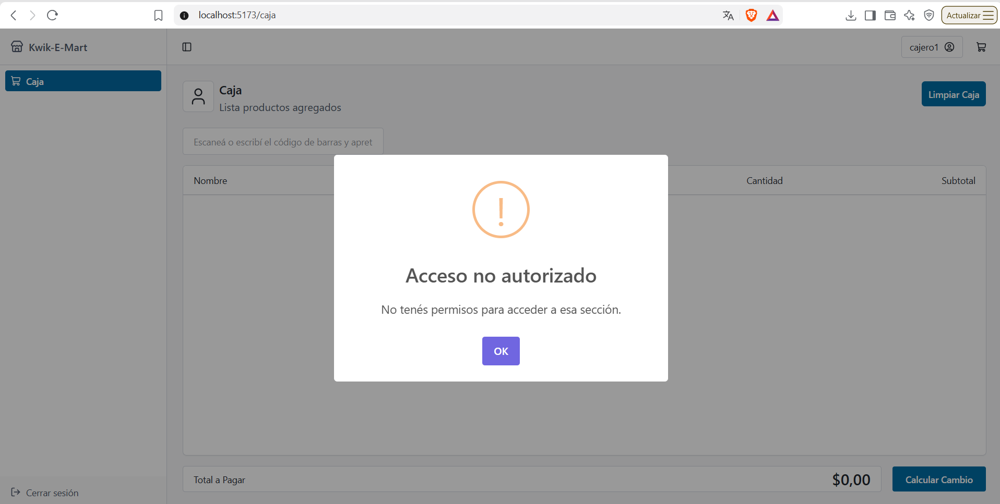
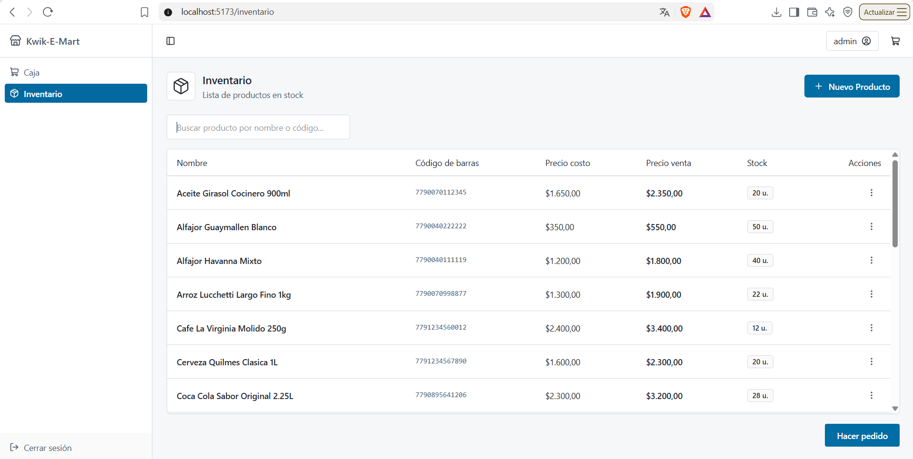
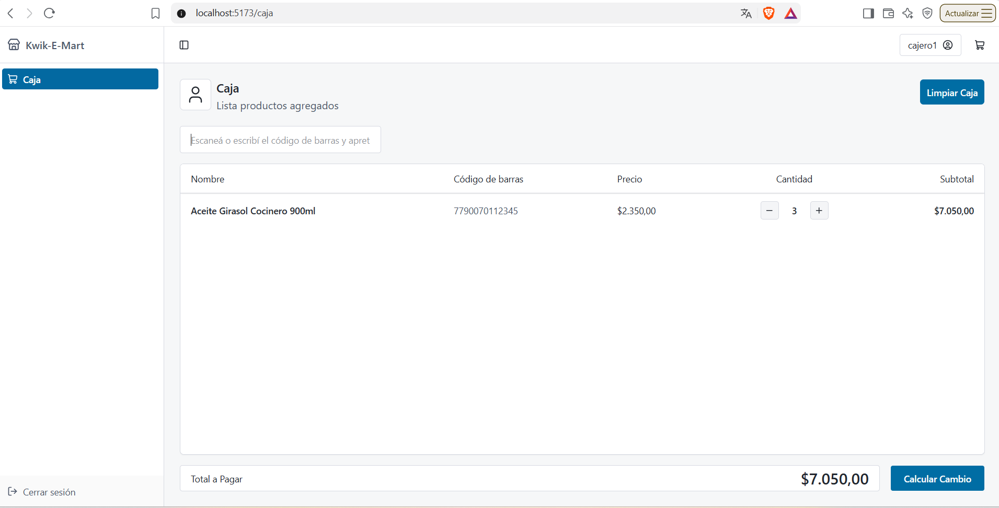
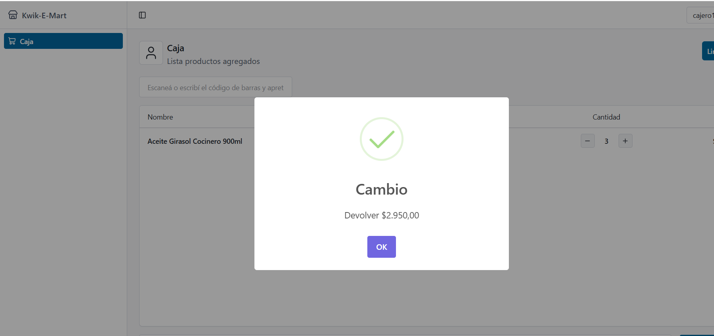

# Scripts de Prueba - Kwik-E-Mart
**Tester / QA:** Federico Siboldi  
**Materia:** Metodologías Superágiles  

---
# Scripts de Prueba - Kwik-E-Mart
**Tester / QA:** Federico Siboldi  
**Materia:** Metodologías Superágiles  
**Issue vinculada:** #33 - Casos de prueba: Cajero intentando acceder a rutas de Admin (HU-02 / Sprint 1)

---

### Script de Prueba 01
| Campo | Detalle |
| :--- | :--- |
| **ID de Caso de Prueba** | TC-AUTH-001 |
| **Nombre de Caso de prueba** | Bloqueo de acceso y ocultamiento de Inventario para rol Cajero |
| **Descripción** | Se probará que un usuario autenticado como Cajero no pueda visualizar la opción de Inventario en el menú lateral ni acceder mediante la URL directa (`/inventario`) para consultar productos o precios de costo. |
| **Precondiciones** | 1. Backend y Frontend en ejecución. 2. Base de datos MySQL conectada. 3. Sesión iniciada con usuario `cajero1`. |
| **Relaciones Casos de uso** | CU: Iniciar sesión / HU-02: Restricción de acceso por rol (Cajero) - Issue #33 |
| **Pasos y condiciones ejecución** | 1. Iniciar sesión con la cuenta de `cajero1`. 2. Comprobar las opciones disponibles en la barra lateral de navegación. 3. Escribir manualmente en la barra de direcciones: `http://localhost:5173/inventario` y presionar Enter. |
| **Resultado Esperado** | 1. En la barra lateral solo debe figurar la opción "Caja". 2. Al ingresar a `/inventario`, el sistema debe denegar el acceso, redirigir a `/caja` y advertir la falta de permisos sin exponer costos. |
| **Estado Caso de Prueba** | [x] Exitoso  /  [ ] Fallido  /  [ ] Frenado  /  [ ] Pendiente |
| **Resultado Obtenido** | El menú lateral solo muestra "Caja". Al tipear la URL `/inventario`, redirige automáticamente a `/caja` mostrando el modal: "Acceso no autorizado: No tenés permisos para acceder a esa sección."   |
| **Errores Asociados** | Ninguno. Comportamiento conforme a los criterios de aceptación. |
| **Responsable Diseño** | Federico Siboldi |
| **Responsable Ejecución** | Federico Siboldi |
| **Comentarios** | Cumple con los requerimientos de restricción y seguridad para perfiles no administrativos. |

---

### Script de Prueba 02
| Campo | Detalle |
| :--- | :--- |
| **ID de Caso de Prueba** | TC-AUTH-002 |
| **Nombre de Caso de prueba** | Acceso completo a módulos administrativos para rol Administrador |
| **Descripción** | Se probará que un usuario con rol Admin pueda visualizar el menú de gestión y acceder a la pantalla de Inventario visualizando costos, stock y alta de productos. |
| **Precondiciones** | 1. Backend y Frontend en ejecución. 2. Sesión iniciada con credenciales de usuario `admin`. |
| **Relaciones Casos de uso** | CU: Administrar catálogo / HU-02: Restricción de acceso por rol - Issue #33 |
| **Pasos y condiciones ejecución** | 1. Iniciar sesión con usuario `admin`. 2. Verificar opciones en el menú lateral. 3. Hacer clic en "Inventario" (`/inventario`). |
| **Resultado Esperado** | Debe mostrar en la barra lateral "Caja" e "Inventario". Al acceder a `/inventario` debe cargar el listado completo con columnas de Precio costo, Precio venta, Stock y botón "+ Nuevo Producto". |
| **Estado Caso de Prueba** | [x] Exitoso  /  [ ] Fallido  /  [ ] Frenado  /  [ ] Pendiente |
| **Resultado Obtenido** | El administrador visualiza "Inventario" en la barra lateral. Al ingresar a `/inventario`, se despliega correctamente la tabla completa con precios de costo, precio venta, stock y botón de nuevo producto.   |

### Script de Prueba 03
| Campo | Detalle |
| :--- | :--- |
| **ID de Caso de Prueba** | TC-POS-001 |
| **Nombre de Caso de prueba** | Carga rápida de producto mediante escaneo/código y tecla Enter |
| **Descripción** | Se probará que al tipear el código de barras y presionar Enter el producto se agregue de inmediato a la tabla con cantidad 1, precio unitario y foco listo para el siguiente producto. |
| **Precondiciones** | 1. Sesión activa en la pantalla `/caja`. 2. Producto registrado en base de datos (`7790070112345` - Aceite Girasol Cocinero 900ml). |
| **Relaciones Casos de uso** | CU: Registrar venta en Caja / HU-10: Escaneo rápido con lector de código de barras (Issue #10) |
| **Pasos y condiciones ejecución** | 1. Posicionar el cursor en el buscador de código de barras. 2. Tipear `7790070112345`. 3. Presionar la tecla Enter sin interacción con el mouse. |
| **Resultado Esperado** | El producto ingresa automáticamente a la tabla con precio de venta ($2.350,00), cantidad 1 y subtotal. El campo de texto queda despejado/enfocado para el siguiente ítem. |
| **Estado Caso de Prueba** | [x] Exitoso  /  [ ] Fallido  /  [ ] Frenado  /  [ ] Pendiente |
| **Resultado Obtenido** | El producto ingresa de inmediato en la tabla con precio de venta y cantidad 1. El buscador queda limpio y listo para ingresar un nuevo código.   |
| **Errores Asociados** | Ninguno. |
| **Responsable Diseño** | Federico Siboldi |
| **Responsable Ejecución** | Federico Siboldi |
| **Comentarios** | Cumple con el criterio de agilidad del Sprint 3 ("sin tener que usar el mouse"). |

---

### Script de Prueba 04
| Campo | Detalle |
| :--- | :--- |
| **ID de Caso de Prueba** | TC-POS-002 |
| **Nombre de Caso de prueba** | Agrupación de producto escaneado de forma reiterada |
| **Descripción** | Se probará que al escanear nuevamente un producto ya presente en la caja no se genere una fila duplicada, sino que se incremente la cantidad y se recalcule el subtotal. |
| **Precondiciones** | 1. Pantalla `/caja` activa. 2. Producto `7790070112345` previamente cargado con cantidad 1. |
| **Relaciones Casos de uso** | CU: Registrar venta en Caja / HU-11: Suma de cantidad por producto repetido (Issue #11) |
| **Pasos y condiciones ejecución** | 1. Ingresar nuevamente en el buscador el código `7790070112345`. 2. Presionar la tecla Enter. |
| **Resultado Esperado** | No se añade una fila nueva. La fila existente actualiza su columna de cantidad a 2 y el subtotal refleja el cálculo correcto ($4.700,00). |
| **Estado Caso de Prueba** | [x] Exitoso  /  [ ] Fallido  /  [ ] Frenado  /  [ ] Pendiente |
| **Resultado Obtenido** | Al ingresar el código nuevamente se mantiene en una sola fila, cambia a cantidad 2 y realiza el cálculo de subtotal a $4.700,00. |
| **Errores Asociados** | Ninguno. |
| **Responsable Diseño** | Federico Siboldi |
| **Responsable Ejecución** | Federico Siboldi |
| **Comentarios** | Cumple con el criterio del Sprint 3 ("si escaneo el mismo alfajor dos veces, que sume cantidad en vez de llenar la pantalla de filas"). |
| **Errores Asociados** | Ninguno. |
| **Responsable Diseño** | Federico Siboldi |
| **Responsable Ejecución** | Federico Siboldi |
| **Comentarios** | Valida el acceso total sin restricciones para el usuario Administrador.

### Script de Prueba 05
| Campo | Detalle |
| :--- | :--- |
| **ID de Caso de Prueba** | TC-POS-003 |
| **Nombre de Caso de prueba** | Incremento manual de cantidad en ítem del carrito |
| **Descripción** | Se probará que al presionar el botón `+` en una fila del changuito se incremente la cantidad solicitada y se actualice el total de la venta. |
| **Precondiciones** | 1. Pantalla `/caja` activa. 2. Producto cargado previamente con cantidad 2. |
| **Relaciones Casos de uso** | CU: Modificar carrito / HU-12: Edicion y eliminacion de items del carrito (Issue #12) |
| **Pasos y condiciones ejecución** | 1. Localizar la fila del producto Aceite Girasol Cocinero 900ml. 2. Hacer clic sobre el botón `+` de la columna Cantidad. |
| **Resultado Esperado** | El contador aumenta a 3 unidades y el subtotal/total se recalcula en base al nuevo valor. |
| **Estado Caso de Prueba** | [x] Exitoso  /  [ ] Fallido  /  [ ] Frenado  /  [ ] Pendiente |
| **Resultado Obtenido** | Al hacer clic sobre el botón `+`, la cantidad del ítem se incrementó inmediatamente de 2 a 3 unidades, recalculando el subtotal y el total a pagar de forma dinámica.   |
| **Errores Asociados** | Ninguno. |
| **Responsable Diseño** | Federico Siboldi |
| **Responsable Ejecución** | Federico Siboldi |
| **Comentarios** | Cumple con los criterios de edición previa al cobro del Sprint 3. |

---

### Script de Prueba 06
| Campo | Detalle |
| :--- | :--- |
| **ID de Caso de Prueba** | TC-POS-004 |
| **Nombre de Caso de prueba** | Cálculo exacto de vuelto / cambio en cobro |
| **Descripción** | Se probará que al ingresar el importe entregado por el cliente en efectivo, el sistema determine e informe en pantalla el cambio exacto a devolver. |
| **Precondiciones** | 1. Carrito con productos (3 unidades de Aceite Cocinero, total $7.050,00). 2. Monto ingresado mayor al total a pagar ($10.000,00). |
| **Relaciones Casos de uso** | CU: Cobro en Caja / HU-13: Cobro y calculo de vuelto (Issue #13) |
| **Pasos y condiciones ejecución** | 1. Presionar el botón "Calcular Cambio". 2. Ingresar el importe con el que abona el cliente ($10.000,00). 3. Confirmar la acción. |
| **Resultado Esperado** | Despliegue de modal informativo indicando el importe a devolver: $2.950,00. |
| **Estado Caso de Prueba** | [x] Exitoso  /  [ ] Fallido  /  [ ] Frenado  /  [ ] Pendiente |
| **Resultado Obtenido** | Al presionar el botón "Calcular Cambio" e ingresar el pago recibido, el sistema desplegó el modal informativo indicando con precisión matemática: "Cambio - Devolver $2.950,00".   |
| **Errores Asociados** | Ninguno. |
| **Responsable Diseño** | Federico Siboldi |
| **Responsable Ejecución** | Federico Siboldi |
| **Comentarios** | Valida el cálculo automático de vuelto del Sprint 3. |